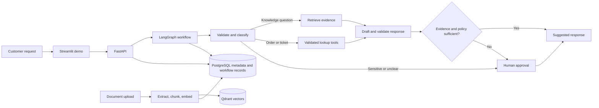
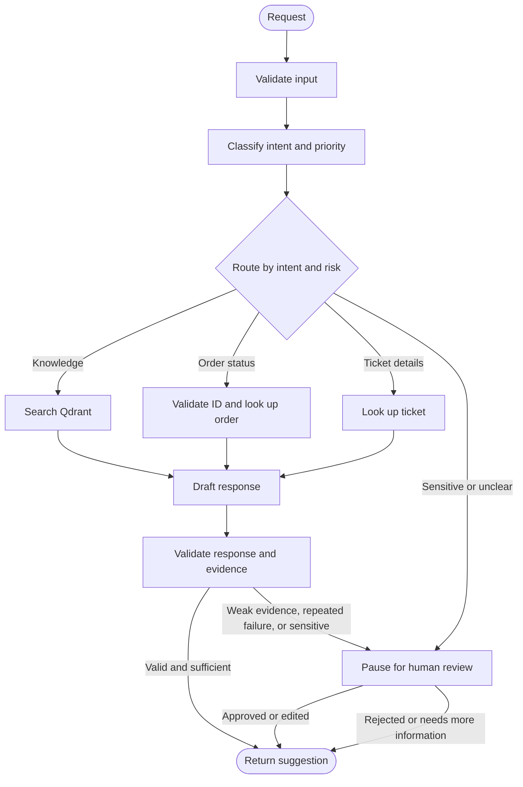
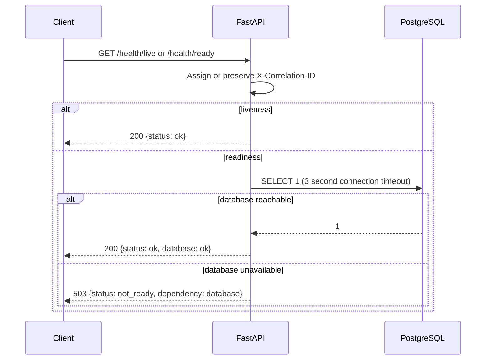
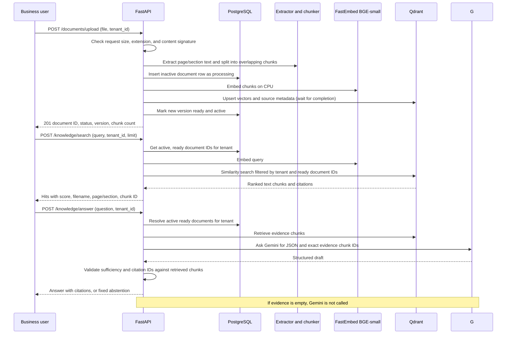
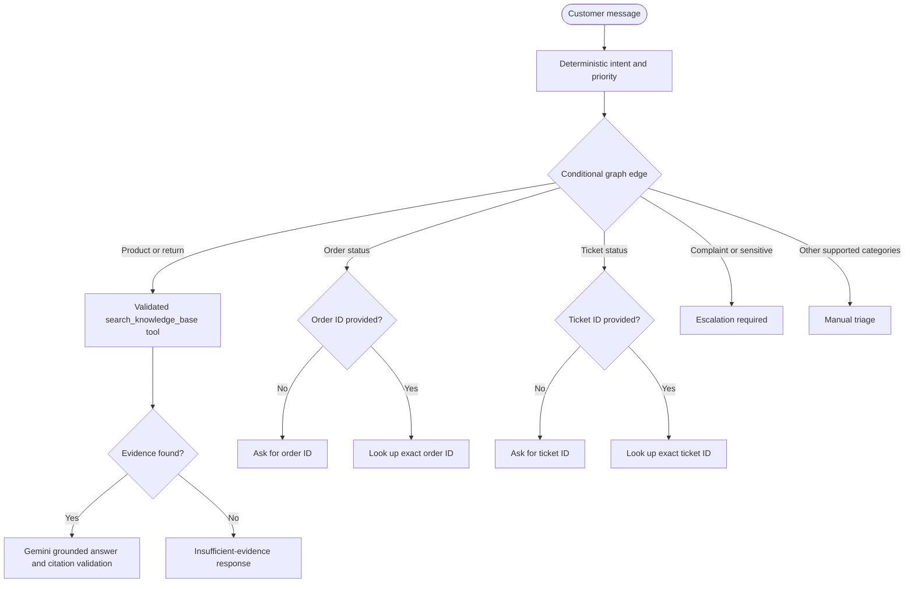

# SupportPilot AI

SupportPilot AI is a portfolio MVP for customer support automation. It answers questions from a business knowledge base, looks up synthetic order and ticket records, drafts replies, and routes uncertain or sensitive cases to a human for review.

The system is designed to show controlled agent behavior: explicit routing, validated tools, bounded recovery, evidence-backed responses, and resumable approval. It will not send messages or issue refunds automatically.

## MVP scope

- Upload FAQ, policy, manual, and PDF files; extract page-aware text and index it in Qdrant.
- Answer knowledge questions with citations and abstain when evidence is weak.
- Classify a request and look up synthetic orders or tickets using typed tools.
- Draft a structured reply with priority, evidence, confidence/validation status, and next action.
- Escalate sensitive or uncertain requests for human approval.
- Demonstrate the workflow through FastAPI and Streamlit, backed by PostgreSQL metadata and LangGraph orchestration.

The local demo uses synthetic data only and leaves authentication disabled. The API has an optional Cognito access-token validation mode that enforces the verified tenant claim; hosted sign-in, roles/scopes, rate limiting, and deployment controls remain follow-up work.

## Architecture



## One request through the system

1. FastAPI validates the request and assigns a correlation ID.
2. The graph stores normalized input and classifies the intent and priority.
3. Conditional routing chooses knowledge retrieval, a specific lookup tool, or escalation.
4. Retrieval returns ranked chunks with document/page metadata; lookup tools query synthetic records through validated inputs.
5. A response node drafts a structured reply from the customer message and returned evidence/tool result.
6. Output validation checks required fields and evidence. Insufficient evidence, tool errors, complaints, and authorization-sensitive actions route to human review.
7. The API returns the suggestion, citations, concise execution events, and any approval status. It does not send the reply.

The graph state contains only the request, classification, retrieved evidence or tool result, bounded error/retry status, draft, validation result, and approval status. It does not store hidden model reasoning. PostgreSQL is the source of truth for application metadata and resumable workflow records; Qdrant stores searchable vectors plus document identifiers and metadata. Ingestion will use document version IDs and replace-or-delete vector points for that version so a failed reindex does not silently mix stale and new chunks.

## Workflow



## Planned directory structure

This is the target structure; modules will be added milestone by milestone rather than as empty placeholders.

```text
supportpilot-ai/
├── app/
│   ├── api/                 # FastAPI routes and dependencies
│   ├── agent/               # LangGraph support state, classifier, and routing
│   ├── core/                # Settings, logging, errors, request IDs
│   ├── db/                  # SQLAlchemy models, session, repositories
│   ├── documents/           # Validation, extraction, chunking, embeddings
│   ├── embeddings/          # Provider-neutral embedding interface and FastEmbed
│   ├── llm/                 # Provider interface and Gemini adapter
│   ├── rag/                 # Qdrant indexing, retrieval, citations
│   ├── schemas/              # Pydantic request and response models
│   ├── services/             # Business workflows independent of API/UI
│   └── tools/                # Typed knowledge, order, ticket, and approval tools
├── frontend/                 # Streamlit demonstration
├── alembic/                  # Versioned PostgreSQL migrations
├── data/
│   ├── eval/                 # Version-controlled evaluation examples
│   └── sample_docs/          # Synthetic sample support documents
├── docs/                     # Architecture, setup, deployment, portfolio notes
├── scripts/                  # Local ingestion and evaluation commands
├── tests/
│   ├── unit/
│   └── integration/
├── .env.example
├── .gitignore
├── alembic.ini
├── compose.yaml
├── Dockerfile
├── pyproject.toml
└── README.md
```

## Milestone 1: local environment

Completed with Python 3.11.9 in a local `.venv`. The `.env` file is ignored by Git; `.env.example` contains safe local defaults and blank optional provider credentials.

## Milestone 2: API, configuration, and database foundation

### What this slice does

FastAPI provides a process liveness endpoint and a readiness endpoint that runs `SELECT 1` against PostgreSQL. Pydantic Settings validates and centralizes configuration. SQLAlchemy 2.x models define the first application tables, and Alembic applies a versioned initial schema. Docker Compose starts the API, PostgreSQL, and Qdrant. Qdrant is present for the next RAG milestone; API readiness currently checks PostgreSQL only.

The initial metadata tables are `documents`, `conversations`, `messages`, `support_tickets`, `mock_orders`, `approval_requests`, and `workflow_executions`. Each tenant-owned record has a `tenant_id`; this is a design boundary only at this milestone, not an implemented authentication or authorization system.

### Execution flow



Liveness answers “is the API process responding?” and intentionally does not depend on PostgreSQL. Readiness answers “can this instance serve database-backed work?” A database failure therefore does not restart-loop a live process but does keep it out of traffic when a deployment platform honors readiness.

### Files added

- `pyproject.toml`: supported Python range and dependency constraints.
- `app/core/config.py`: environment-backed settings.
- `app/api/health.py`, `app/main.py`: health routes and request correlation IDs.
- `app/db/`: SQLAlchemy base, session/engine, and metadata models.
- `alembic.ini`, `alembic/env.py`, `alembic/versions/0001_initial_schema.py`: migration environment and initial schema.
- `compose.yaml`, `Dockerfile`, `.dockerignore`: local container setup.
- `tests/test_health.py`: liveness and readiness behavior.

### Design decisions

- The API uses synchronous SQLAlchemy sessions for this small request/response service. This keeps database behavior straightforward and avoids mixing async and sync drivers; async can be considered if measured database concurrency warrants it.
- PostgreSQL is the source of truth for records and workflow metadata. JSONB is used only for extensible metadata and small structured payloads; fields needed for filtering remain typed columns with indexes.
- Migrations are explicit and versioned rather than creating tables at application startup. API startup does not silently mutate the database.
- Request correlation IDs are echoed in `X-Correlation-ID` and included in error logs. This is not yet full distributed tracing.
- The mock order table is synthetic. No customer identifiers or payment data are included.

### Install and run (PowerShell)

Activate the existing virtual environment, then install the application and developer tools:

```powershell
python -m pip install -e ".[dev]"
docker compose up --build -d
docker compose ps
```

Compose waits for PostgreSQL to pass its health check, runs `alembic upgrade head`, then starts the API. Qdrant listens on port 6333 and the API listens on port 8000, both bound to loopback. PostgreSQL is reachable only inside the Compose network, where the API uses the `postgres` service name; it does not publish a host port.

Check the endpoints:

```powershell
Invoke-RestMethod http://127.0.0.1:8000/health/live
Invoke-RestMethod http://127.0.0.1:8000/health/ready
```

Expected JSON:

```json
{"status":"ok"}
{"status":"ok","database":"ok"}
```

To check correlation ID behavior and the OpenAPI page, open `http://127.0.0.1:8000/docs` or run:

```powershell
Invoke-WebRequest http://127.0.0.1:8000/health/live -Headers @{"X-Correlation-ID"="demo-123"} | Select-Object StatusCode, Headers
```

The response should include `X-Correlation-ID: demo-123`. To stop containers while preserving local database/vector data, run `docker compose down`. `docker compose down -v` also removes local data volumes.

### Tests and migration check

With the virtual environment active:

```powershell
python -m pytest
```

The health tests use a test client and stub the database check, so they do not require Docker. Compose runs the migration automatically before starting its API container. PostgreSQL is intentionally not published on a host port; use the API container or `docker compose exec postgres psql -U supportpilot -d supportpilot` for local inspection.

### Environment variables

The full template is in `.env.example`. Key settings are `DATABASE_URL`, `QDRANT_URL`, `QDRANT_API_KEY`, `GEMINI_API_KEY`, `GEMINI_MODEL`, `EMBEDDING_MODEL`, chunk size/overlap, upload limit, and optional LangSmith tracing values. Gemini and LangSmith are not required to run the search milestone. Compose sets its internal database URL to reach the PostgreSQL service by its Compose name.

### Troubleshooting

- If `docker compose` is unavailable, install/start Docker Desktop and retry.
- If a port is already occupied, change the left-hand host port in `compose.yaml` and use that port in the URL; keep container-side ports unchanged.
- If `/health/live` works but readiness returns 503, inspect `docker compose logs postgres api`; confirm the PostgreSQL health check passes and the API uses the Compose database URL.
- If migration reports an existing incompatible schema, stop and inspect the local database before applying changes; do not delete the volume unless its data is disposable.
- On Windows, `Invoke-RestMethod` uses system proxy settings; if loopback is proxied, bypass the proxy for `127.0.0.1` or use `curl.exe --noproxy "*"`.

### Security and reliability limits

`.env` is excluded from Git. Compose binds published services to loopback, uses bounded database connect/pool timeouts, and exposes no automatic customer action. The included Compose password is for local development only. Local Compose has `AUTH_ENABLED=false`. The API can validate Cognito access tokens when enabled, rejects tenant IDs that differ from the signed `tenant_id` claim, and requires a reviewer scope for approval decisions. A Cognito user pool, trusted tenant-claim trigger, hosted UI login, rate limiting, TLS, secret management, and production database operations are not configured. Do not expose this Compose setup publicly. See [production readiness gaps](docs/production_readiness.md).

### Acceptance criteria

- `python -m pytest` passes all three health behavior tests.
- `docker compose up --build -d` starts the API after PostgreSQL is healthy and applies migration `0001_initial`.
- `/health/live` returns 200 without requiring PostgreSQL; `/health/ready` returns 200 with PostgreSQL and 503 when the database check fails.
- Both success and error responses carry a correlation ID.

### Interview questions

1. Why should liveness and readiness be separate checks?
2. Why does the app use Alembic instead of `Base.metadata.create_all()` on startup?
3. What does `pool_pre_ping` protect against, and what does it not protect against?
4. How would you enforce `tenant_id` isolation once authentication is added?
5. Why is database readiness checked with a lightweight `SELECT 1`?

## Milestone 3: document ingestion and retrieval

### Business purpose and execution flow

This slice lets a business index synthetic FAQs and policies, retrieve relevant excerpts, and draft a grounded answer with citations. It supports PDF, UTF-8 plain text, and Markdown. A request flows through validation, extraction, chunking, embedding, Qdrant storage, and vector search. Answer generation uses Gemini structured output and validates every citation against the retrieved chunks before returning it.



## Milestone 4 — Grounded answer generation

The `POST /knowledge/answer` endpoint retrieves the tenant's active, ready policy chunks, gives those excerpts to a replaceable answer provider, and returns an answer only when the provider says the evidence is sufficient and cites one or more exact retrieved chunk IDs. Each citation includes filename, page/section, and the excerpt. Unknown, missing, or duplicate citations and provider-level abstention produce a fixed insufficient-evidence response with no citations. Empty retrieval skips the LLM entirely. Provider failures return HTTP 503 rather than invented content.

The Gemini adapter uses structured JSON output with `gemini-3.6-flash` by default. The model prompt treats document content as untrusted reference text, so instructions embedded in uploaded files are not followed. This is a guardrail rather than a guarantee of factuality; human review remains appropriate before a customer-facing message is sent. The default does not use a raw similarity-score threshold because vector scores are ranking values rather than calibrated confidence.

To check the configured Gemini key and model independently of the running API, run [the Gemini API smoke-test notebook](notebooks/gemini_api_smoke_test.ipynb). It loads local settings without displaying the key and sends one request with synthetic evidence.

Add a Google AI Studio API key as `GEMINI_API_KEY` in the local `.env` file to enable answers. Do not paste credentials into the repository or chat. Without a key, `/knowledge/answer` returns 503 when relevant chunks exist; if no chunks match, it returns the abstention without needing a key.

```powershell
# After placing GEMINI_API_KEY and optionally GEMINI_MODEL in .env:
docker compose up --build -d
Invoke-RestMethod -Method Post -Uri http://127.0.0.1:8000/knowledge/answer -ContentType "application/json" -Body '{"tenant_id":"demo","question":"What should a customer do if an item arrived damaged?","limit":3}'
```

An answered response has `status: "answered"`, concise `answer`, and `citations` with the exact retrieved source metadata. An unsupported question returns `status: "insufficient_evidence"` and: `I don't have enough information in the available documents to answer that.` This milestone tests answer validation using a fake provider; real answer quality still needs a reviewed evaluation set and is not claimed as measured.

Google's current model ID and structured output format are documented in the [Gemini models guide](https://ai.google.dev/gemini-api/docs/models) and [structured outputs guide](https://ai.google.dev/gemini-api/docs/structured-output). The adapter calls the documented Gemini `generateContent` REST API through `httpx`.

### Concepts and decisions

- **Extraction keeps provenance.** PDF text is extracted page by page; Markdown headings become section metadata; text files have no page number. Scanned image PDFs are rejected because OCR is not included yet.
- **Chunking uses characters in this baseline.** The defaults are 800 characters with 120 characters of overlap. Character windows are easy to inspect and keep within a predictable payload size. Token-aware splitting is an alternative if evaluation shows that chunks cut off useful context.
- **Embeddings are a replaceable service.** FastEmbed runs `BAAI/bge-small-en-v1.5` locally on CPU and keeps the 384-dimensional output expected by the Qdrant collection. FastEmbed's query/document methods use the model's retrieval-specific paths. The model cache is kept in a named Compose volume.
- **Qdrant stores vectors and retrieval payloads.** Each point has chunk text, tenant/document IDs, file type, checksum, page/section, and chunk index. Keyword payload indexes support tenant and document filters. PostgreSQL stores document status/version metadata, not the raw uploaded files.
- **PostgreSQL controls which vectors can be retrieved.** The search service first loads active, ready document IDs for the requested tenant, then requires both the tenant ID and one of those document IDs in Qdrant. This keeps processing, failed, inactive, and other-tenant chunks out of results.
- **Re-uploads use document versions.** The same tenant and filename gets a new version. It remains inactive until its vectors are stored; PostgreSQL then atomically activates it and deactivates the old version. Old vectors are deleted afterward. If deletion fails, the old version is already excluded from search. If the process crashes after vector upsert but before the PostgreSQL commit, the row remains non-ready and search excludes its points; automatic orphan cleanup is a future operational task.
- **No cross-store transaction exists.** Ingestion uses a compensating workflow: on error, it deletes any newly written vectors and marks the document failed. A database outage during that compensation may leave unreachable vectors, but the ready-ID filter prevents them from appearing in search.
- **The initial endpoint runs ingestion synchronously.** This keeps the local demo easy to follow. A production service handling larger files should hand the processing step to a background worker and report processing status asynchronously.

### Files added or updated

- `app/documents/extractor.py`, `app/documents/chunking.py`: safe extension/content validation, page-aware text extraction, and overlap chunking.
- `app/embeddings/provider.py`: embedding interface and cached FastEmbed provider.
- `app/rag/qdrant_store.py`: collection setup, payload indexes, upsert, tenant-filtered search, and scoped cleanup.
- `app/services/document_ingestion.py`, `app/services/knowledge_search.py`: business workflows and PostgreSQL/Qdrant coordination.
- `app/api/documents.py`, `app/api/knowledge.py`: upload, document status/list, and search routes.
- `app/schemas/documents.py`: typed request and response models.
- `alembic/versions/0002_document_versions.py`: active-document version support.
- `data/sample_docs/return_policy.md`: synthetic sample content.
- `tests/test_documents.py`, `tests/test_qdrant_store.py`, `tests/test_document_api.py`: extraction, chunking, vector filters, and request validation.

### Install and run (PowerShell)

The project dependencies are pinned in `pyproject.toml`. Rebuild Compose to apply the new API package, migration, and Qdrant image:

```powershell
python -m pip install -e ".[dev]"
docker compose up --build -d
docker compose ps
```

The first upload downloads the BGE ONNX model into the persistent `embedding_model_cache` volume and can take a few minutes. Milestone 3 upload and search do not need a Gemini key; answer generation needs one when evidence exists. Inspect logs with `docker compose logs --tail 100 api`.

### Example upload and retrieval

Upload the synthetic return policy:

```powershell
curl.exe -F "file=@data/sample_docs/return_policy.md" -F "tenant_id=demo" http://127.0.0.1:8000/documents/upload
```

The response is HTTP 201 and includes a UUID `id`, `status: "ready"`, `version: 1`, `is_active: true`, and a positive `chunk_count`. Use the returned UUID if you want to inspect it with `GET /documents/{id}?tenant_id=demo`.

Search it:

```powershell
Invoke-RestMethod -Method Post -Uri http://127.0.0.1:8000/knowledge/search -ContentType "application/json" -Body '{"tenant_id":"demo","query":"What should a customer do if an item arrived damaged?","limit":3}'
```

The response contains `hits`; each hit includes `filename`, `page_number` (PDF only), `section` (Markdown heading when available), `score`, and the retrieved chunk text. A score is for ranking and is not a confidence probability or an abstention threshold.

The upload returns 400 for unsupported types, invalid UTF-8, malformed PDFs, and PDFs without selectable text; it returns 413 for files above `UPLOAD_MAX_MB` (20 MB by default). Search validates its query and limits `limit` to 1–10. The tenant ID is a demo filter, not an authenticated identity.

### Tests and acceptance criteria

Run:

```powershell
python -m pytest
```

The suite checks UTF-8/Markdown/PDF extraction, page/section preservation, chunk overlap and bounds, unsupported content rejection, Qdrant retrieval and tenant isolation, scoped vector deletion, and API validation. The live milestone acceptance check is to upload the sample policy, confirm the document is `ready`, and retrieve a damaged-item chunk with a source section. Search from a different tenant should return no hits.

### Common issues and limits

- If upload returns 503 on first use, check that Qdrant is healthy and that the container can reach Hugging Face to download the model. The model cache persists across container restarts.
- If collection initialization reports a vector-size mismatch, use a new `QDRANT_COLLECTION` when changing to a model with a different vector dimension.
- PyMuPDF 2.1 is dual licensed under AGPL-3.0 or a commercial license. The portfolio repository is open source; check licensing before embedding it in a closed-source client product. A lighter parser such as pypdf is an alternative with different text/layout behavior.
- Tenant filtering is not authorization. There is no login, role policy, per-user ownership check, or cloud Qdrant API key in this local demo. Do not expose it to the public internet.
- Request size is capped at the API boundary; a production deployment should also enforce body limits at its reverse proxy/load balancer and scan uploads before processing.

### Interview questions

1. Why preserve page and section metadata through extraction and chunking?
2. How does the active-version swap avoid making a half-indexed file searchable?
3. Why is a successful Qdrant write followed by a PostgreSQL commit not a distributed transaction?
4. Why filter Qdrant results against PostgreSQL's active ready documents?
5. How would you evaluate whether 800-character chunks and 120-character overlap are appropriate for a customer's documents?

## Milestone 5 — LangGraph classification and routing

### Business purpose

`POST /agent/run` accepts a support message, classifies its intent and priority, and routes it through a typed LangGraph workflow. Product and return/refund requests invoke the validated `search_knowledge_base` tool and reuse Milestone 4's grounded answer generation. Order and ticket questions ask for a missing identifier or invoke their tenant-scoped mock lookup tool. Complaints and sensitive phrases route to human review. Technical, billing, and unrecognized requests are classified and marked for manual triage instead of receiving unsupported answers.



### Concepts and design decisions

- **State** is a typed snapshot passed between graph steps: tenant, customer message, order ID, classification, route, answer, citations, and concise execution events. It excludes secrets and hidden model reasoning.
- **Nodes** perform one action (classify, search/answer, ask for an order ID, or escalate). **Conditional edges** choose which node runs based on the validated route.
- **Classification is deterministic for this baseline.** Explicit phrase rules avoid an extra model call and make decisions easy to test. The rule order handles sensitive complaints before normal policy questions. Evaluate an intent dataset before deciding whether an LLM classifier would improve results.
- **The knowledge search tool is schema-validated.** Its query, tenant, and result limit are checked with Pydantic before calling the existing service, which still filters to that tenant's active, ready documents. The graph decides when to call it; the model does not choose arbitrary tools.
- **Record handling is deliberately bounded.** Missing identifiers prompt for an order or ticket number. The workflow does not invent a record status when an exact lookup returns no result.
- The graph is compiled per request and has no checkpoint persistence yet. LangGraph checkpointing and pause/resume approval belong to Milestone 7.

### Files added or changed

- `app/agent/classification.py`: deterministic intent/priority rules and route mapping.
- `app/agent/workflow.py`: typed graph state, node functions, conditional edges, and workflow compilation.
- `app/tools/knowledge.py`: Pydantic-validated `search_knowledge_base` tool.
- `app/schemas/agent.py`, `app/api/agent.py`: request/response models and `POST /agent/run`.
- `app/main.py`: mounts the agent API.
- `tests/test_agent_workflow.py`, `tests/test_agent_api.py`: classification, routing, tool validation, abstention, and endpoint behavior.

### Install and run (PowerShell)

LangGraph and LangChain Core are pinned in `pyproject.toml`. Install and rebuild the API so the container receives them:

```powershell
python -m pip install -e ".[dev]"
docker compose up --build -d
docker compose ps
```

Call the support graph:

```powershell
Invoke-RestMethod -Method Post -Uri http://127.0.0.1:8000/agent/run -ContentType "application/json" -Body '{"tenant_id":"demo","message":"What should I do if an item arrived damaged?","limit":3}'
```

An evidence-backed response includes `intent: "return_refund"`, `route: "knowledge_lookup"`, `status: "answered"`, an answer, citations, concise `events`, and a persisted `workflow_id`. A request such as `Where is my order?` returns `status: "needs_input"` with `next_action: "ask_for_order_id"`. A sensitive complaint returns `status: "approval_pending"` and a `workflow_id` for review. An empty knowledge base returns the fixed abstention. The endpoint does not send messages or change orders.

Run the suite with `python -m pytest`. Milestone 5 tests cover seven intent/priority examples, validated tool inputs, the knowledge path, empty-evidence abstention, order-ID collection, human escalation, and FastAPI responses. The tests use fake providers and do not call Gemini.

### Reliability, security, and acceptance

Request shape is validated by Pydantic, tool arguments are revalidated at invocation, retrieval retains tenant/active-document filtering, and provider/store failures use bounded service errors. Classification is a transparent heuristic baseline, not a trained accuracy claim. Authentication and authorization are still not implemented.

Acceptance: the test suite passes; `/agent/run` returns a cited answer for the synthetic damaged-item policy; a missing order number is requested; a sensitive complaint routes to human review; unsupported knowledge abstains. LangGraph's [Graph API](https://docs.langchain.com/oss/python/langgraph/graph-api) and [quickstart](https://docs.langchain.com/oss/python/langgraph/quickstart) describe the state/node/edge model and tool-enabled workflows used here.

### Interview questions

1. What belongs in graph state, and why keep prompt text and credentials out of it?
2. Why is classification deterministic here, and how would you measure whether to replace it?
3. How does the conditional edge constrain which tool can run?
4. Why does a tool validate its arguments even when the API already validates its request?
5. What changes are needed to pause and resume a graph after human approval?

## Milestone 6 — synthetic order and ticket lookup tools

The order route now requires an order number and then calls `lookup_mock_order`; the ticket route similarly calls `lookup_mock_ticket`. Each tool validates its arguments and performs an exact match on both `tenant_id` and `external_id`. They are read-only and return only a small set of synthetic status fields. A missing record returns `record_not_found` and a verification action. Complaints still go to human review before any ticket lookup route can run.

Create the deterministic demo records after Compose has applied the initial schema:

```powershell
docker compose exec api python -m scripts.seed_demo_records
```

Then try an order or ticket lookup:

```powershell
Invoke-RestMethod -Method Post -Uri http://127.0.0.1:8000/agent/run -ContentType "application/json" -Body '{"tenant_id":"demo","message":"Where is my order?","order_id":"ORD-1001"}'
Invoke-RestMethod -Method Post -Uri http://127.0.0.1:8000/agent/run -ContentType "application/json" -Body '{"tenant_id":"demo","message":"Check my ticket","ticket_id":"TKT-2001"}'
```

The seed command is idempotent and inserts only absent IDs. Use an unknown identifier to see the bounded `record_not_found` result. These examples are synthetic; the tools neither update records nor perform customer actions.

Files: `app/tools/support_records.py` defines the validated DB tools; `app/agent/classification.py` recognizes ticket-status requests; `app/agent/workflow.py` routes and formats the results; `scripts/seed_demo_records.py` seeds the demo; workflow tests cover missing identifiers, found records, and not-found behavior.

## Milestone 7 — validation, recovery, approval, and checkpoints

Every `/agent/run` creates a UUID workflow record in PostgreSQL. The API passes that ID as LangGraph's `thread_id`; `PostgresSaver` writes execution checkpoints to PostgreSQL so an interrupted graph can resume after the API process restarts. On first agent use, the saver creates its checkpoint tables with `setup()`. The app also keeps a concise public state snapshot in `workflow_executions.state_json`, while `approval_requests` records the reviewer decision. Checkpoints use the LangGraph serializer's safe built-in type allowlist.

The sensitive complaint route calls LangGraph `interrupt()` with a review payload. The API stores a pending approval and returns `status: "approval_pending"`, `workflow_id`, and `approval_id`; no outgoing message is sent. A reviewer can inspect the persisted status and resume the paused graph with an approval or rejection. An approved draft is marked `approved` and still requires a person to send it manually. A rejected draft returns to manual triage. Duplicate decisions return HTTP 409.

```mermaid
sequenceDiagram
    participant C as Client
    participant A as FastAPI
    participant G as LangGraph
    participant P as PostgreSQL
    C->>A: POST /agent/run
    A->>P: Insert workflow execution
    A->>G: Invoke with thread_id = workflow UUID
    G->>P: Save checkpoint at interrupt()
    A->>P: Insert pending approval; set waiting_approval
    A-->>C: approval_pending + workflow_id
    C->>A: GET /agent/{workflow_id}?tenant_id=demo
    A->>P: Read workflow and approval status
    A-->>C: Current workflow snapshot
    C->>A: POST /agent/{workflow_id}/decision
    A->>G: Command(resume=decision), same thread_id
    G->>P: Read checkpoint and save final state
    A->>P: Record decision and completed workflow state
    A-->>C: approved or rejected result
```

Rebuild and start the project after installing the pinned dependency:

```powershell
python -m pip install -e ".[dev]"
docker compose up --build -d
```

Try a complaint that must pause for review, then inspect and approve it:

```powershell
$pending = Invoke-RestMethod -Method Post -Uri http://127.0.0.1:8000/agent/run -ContentType "application/json" -Body '{"tenant_id":"demo","message":"I want to make a complaint about an unsafe product"}'
$pending
Invoke-RestMethod "http://127.0.0.1:8000/agent/$($pending.workflow_id)?tenant_id=demo"
Invoke-RestMethod -Method Post -Uri "http://127.0.0.1:8000/agent/$($pending.workflow_id)/decision" -ContentType "application/json" -Body '{"tenant_id":"demo","decision":"approve","edited_answer":"A support specialist will contact you about this report."}'
```

The start response should include `status: "approval_pending"`. The decision response should include `status: "approved"` and `next_action: "send_approved_reply_manually"`. To reject, pass `"decision":"reject"`; to see the duplicate-decision guard, submit a second decision and expect HTTP 409. Local Compose leaves authentication disabled. When Cognito auth is enabled, `GET /agent/{workflow_id}` and decision routes require the requested tenant to match the verified access-token claim. The UI accepts a short-lived Cognito access token manually; hosted sign-in and reviewer role scopes are not implemented.

Output is validated with `AgentResponse` before returning. The Gemini adapter retries HTTP 503 up to three times with bounded backoff, invalid structured answer output safely abstains, and workflow exceptions are recorded as `failed` with an error class before a sanitized API error is returned. This milestone does not add retries for database or Qdrant errors, and it never sends an approved reply.

Files: `app/agent/checkpointer.py` manages the bounded checkpoint pool and safe serializer; `app/agent/workflow.py` pauses and resumes on human review; `app/api/agent.py` persists runs, exposes status/decision endpoints, validates output, and records failures; `app/schemas/agent.py` validates decisions and responses. Tests exercise pause/resume, approved edits, workflow status, and the duplicate-decision guard.

## Configuration and data handling

Copy `.env.example` to `.env` for local configuration. Never commit `.env` or real customer data. All customer/order examples in this portfolio project must be synthetic.

## Streamlit demo UI

The local Streamlit console gives you one place to try the implemented flows: upload and list knowledge documents, ask a question and inspect citations, look up synthetic orders/tickets, load and decide pending human-review workflows, and review the saved agent/retrieval evaluation baselines. It calls FastAPI over HTTP; provider keys remain in the API's `.env` and are never entered into the UI.

Start the complete local demo, including the containerized UI:

```powershell
docker compose up --build -d
```

Open `http://127.0.0.1:8501`. The UI container reaches FastAPI over the internal Compose network, and the API is available on the host at `http://127.0.0.1:8000`. Use **Check API** in the sidebar to verify readiness. Upload a policy first, then ask a question on **Ask SupportPilot**. For mock lookup examples, seed the demo records with `docker compose exec api python -m scripts.seed_demo_records`, then use `ORD-1001` or `TKT-2001` on **Orders & Tickets**. Start a sensitive complaint to see it appear in **Human Review**, where you can approve an edited draft or reject it for triage. The interface does not send messages.

See [deployment and operations guidance](docs/deployment.md) and the [two-minute demo script](docs/demo_script.md).

The UI is intended for a local synthetic-data demo. Cognito authentication is disabled in local Compose. The API's optional Cognito mode requires a configured user pool and trusted tenant claim, and the UI currently has no hosted sign-in or refresh flow. Do not bind this setup to a public interface.

## Milestone 9 — tests, evaluation data, and measurements

The automated suite covers API and service behavior, and dataset checks keep the labeled examples aligned with the deterministic classifier. `data/eval/agent_cases.jsonl` contains 19 synthetic examples with expected intent, priority, route, tool selection, final workflow status, and human-review expectation. `scripts/evaluate_agent.py` runs those examples through the graph with stub tools and an in-memory checkpointer. It reports exact-match accuracies and graph invocation latency; the checked-in baseline is `reports/evaluation/agent_baseline.json`.

The baseline measured 19/19 correct for intent, priority, route, tool selection, status, and human-review routing. The recorded local graph invocation p50 was 2.054 ms and p95 was 5.091 ms. These latency values cover an in-process graph with stub tools and `InMemorySaver`; they exclude PostgreSQL, Qdrant, embedding generation, Gemini, and network time. The 100% scores reflect a small, hand-authored set designed around current deterministic rules; they do not estimate production accuracy.

Retrieval examples in `data/eval/retrieval_cases.jsonl` label expected `(filename, section)` targets. The live search evaluator computes Recall@k and MRR and times `POST /knowledge/search` across repeat runs. On the synthetic return-policy set, the recorded run measured Recall@5 1.0, MRR 1.0, p50 53.87 ms, and p95 55.63 ms across 3 queries × 3 requests. This tiny single-document result only checks that the current pipeline retrieves the labeled sections; it is not a general retrieval-quality or production-latency claim. Start Compose, upload the synthetic policy document to tenant `demo` from the UI, then run:

```powershell
python -m scripts.evaluate_retrieval --tenant-id demo --k 5 --repeats 3 --output reports/evaluation/retrieval_baseline.json
```

The retrieval evaluator requires a working API, database, Qdrant collection, and indexed sample document. Its search latency excludes answer generation and UI rendering. The measured artifact is `reports/evaluation/retrieval_baseline.json`.

Run the offline evaluation and suite with:

```powershell
python -m scripts.evaluate_agent --output reports/evaluation/agent_baseline.json
python -m pytest
```

This milestone does not measure Gemini answer factuality, token cost, load capacity, or production traffic. Those require a reviewed answer dataset and realistic hosted dependencies.

## Current status

- Milestone 1: complete (verified Python 3.11.9).
- Milestone 2: complete (health routes and PostgreSQL readiness verified in Compose).
- Milestone 3: complete (16 tests pass; Compose upload, semantic retrieval, tenant filtering, and repeat-upload idempotency verified).
- Milestone 4: complete; live answer generation verified with `gemini-3.6-flash`, including a citation to the damaged-items policy section.
- Milestone 5: complete; 36 tests pass, and live Compose checks verified cited knowledge answers, order-ID collection, and urgent complaint escalation.
- Milestone 6: mock order and ticket lookup tools are tenant-scoped and read-only; run the seeder and use `ORD-1001` or `TKT-2001` for the demo.
- Milestone 7: PostgreSQL checkpointing and human approval implemented; automated pause/resume tests use `InMemorySaver`. The current API image exposes status and decision endpoints; durable PostgreSQL pause/resume has not been exercised end to end yet.
- Milestone 8: Streamlit console supports document ingestion, knowledge answers, order/ticket lookups, human approval, and saved evaluation results. The full UI workflow still needs a manual browser walkthrough.
- Milestone 9: versioned agent and retrieval datasets, offline graph evaluator, live retrieval evaluator, and tests added; 47 tests pass. Agent and live retrieval baselines are recorded in `reports/evaluation/` with their measurement scope and limits.
- Milestone 10: the full local Compose stack includes the Streamlit UI; deployment guidance, portfolio case study, demo script, and Upwork portfolio copy are documented.
- Security follow-up: initial AWS Cognito access-token verification and tenant-claim checks are implemented behind `AUTH_ENABLED`. A reference pre-token trigger and setup instructions are in [Cognito setup](docs/cognito_setup.md). Tests use synthetic keys and tokens; a real Cognito user pool or token has not yet been configured or tested. See the production readiness tracker for UI sign-in and other remaining gaps.

See the [portfolio case study](docs/portfolio_case_study.md) for architecture and measured results, the [production readiness gap tracker](docs/production_readiness.md) for the remaining work and closure evidence, and [Upwork portfolio copy and service packages](docs/upwork_portfolio.md) for editable profile material. The Compose stack is for local/private demos only, not public customer traffic.

SupportPilot AI is an independently developed portfolio project, not a client-sponsored deployment.
